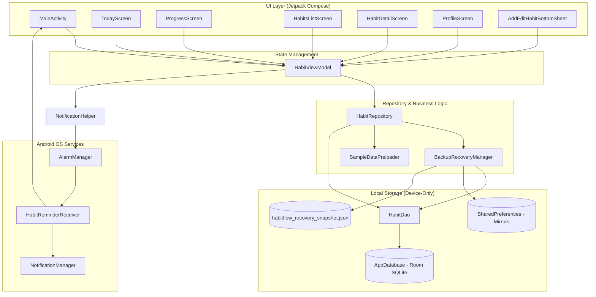

# HabitFlow — Application Architecture & Technical Documentation

## 1. Project Overview & Technology Stack

**HabitFlow** is a modern, offline-first personal habit tracker and self-discipline mobile application built natively for Android. It emphasizes daily momentum, gamified habit consistency (featuring a 70% completion threshold to earn daily streaks and a recovery "lives" mechanic), activity heatmaps, weekly/monthly progress trends, and smart morning/habit notifications.

### 1.1 Technology Stack Summary

| Layer | Technology | Details / Versions |
| :--- | :--- | :--- |
| **Operating System & Platform** | Android Native (Mobile / Tablet) | `minSdk = 24` (Android 7.0 Nougat), `targetSdk = 36`, `compileSdk = 36` |
| **Language** | Kotlin | `2.2.10` with Kotlin Symbol Processing (`KSP 2.3.5`) |
| **UI Framework** | Jetpack Compose & Material 3 | Compose BOM `2024.09.00`, Material 3, Material Icons Extended |
| **Architecture** | MVVM + Repository Pattern | `AndroidViewModel`, StateFlow / SharedFlow, Coroutines 1.10.2 |
| **Local Database & Persistence** | Android Room & SQLite | Room `2.7.0` (Runtime, KTX, KSP Compiler), Room Migrations |
| **State & Preference Mirroring**| SharedPreferences + JSON Files | Internal private storage fallback (`habitflow_cloud_backup_prefs`) |
| **Background Scheduling** | Android AlarmManager | `AlarmManager.RTC_WAKEUP` + `BroadcastReceiver` (`HabitReminderReceiver`) |
| **Build & Tooling** | Gradle 9.3.1 & AGP 9.1.1 | Kotlin DSL (`build.gradle.kts`), Java 11/17 bytecode target |
| **CI / CD Automation** | GitHub Actions | Workflows for debug APK builds and signed release APK publishing |
| **Testing** | JUnit4, Robolectric, AndroidX Test | Robolectric `4.16.1`, Espresso Core `3.7.0`, Coroutines Test `1.10.2` |
| **Declared (Unused) Libraries**| Retrofit, Moshi, OkHttp, Firebase | Included in build files for future server sync / AI, but currently inactive |

---

## 2. Directory Structure & File Inventory

```
Habit_tracker/
├── .github/
│   └── workflows/
│       ├── build-apk.yml             # CI workflow: compiles and uploads debug APK
│       └── release-apk.yml           # CI/CD workflow: validates tags, signs, and releases APK
├── .env.example                      # Secrets template for Gemini API key
├── .gitignore                        # Git exclusion rules (build artifacts, keys, .env)
├── build.gradle.kts                  # Root project build script (plugin aliases)
├── gradle.properties                 # Gradle JVM settings and AndroidX flags
├── gradlew / gradlew.bat             # Gradle wrapper executable scripts
├── metadata.json                     # AI Studio application metadata and capabilities
├── settings.gradle.kts               # Gradle settings: repositories and subproject inclusion
├── gradle/
│   ├── libs.versions.toml            # Centralized Gradle version catalog
│   └── wrapper/
│       ├── gradle-wrapper.jar
│       └── gradle-wrapper.properties # Gradle 9.3.1 distribution spec
├── public/
│   └── assets/aistudio/              # Screenshots and visual promotional assets
└── app/
    ├── build.gradle.kts              # Application module build script, dependencies, configs
    ├── proguard-rules.pro            # ProGuard / R8 code-shrinking rules
    ├── src/
    │   ├── main/
    │   │   ├── AndroidManifest.xml   # Manifest: permissions, activities, receivers, backup rules
    │   │   ├── res/                  # Android resources (drawables, mipmaps, strings, backup XML)
    │   │   │   ├── values/           # strings.xml, colors.xml, themes.xml
    │   │   │   ├── xml/              # backup_rules.xml, data_extraction_rules.xml
    │   │   │   └── mipmap-*/         # Application launcher icons
    │   │   └── java/com/example/
    │   │       ├── MainActivity.kt   # Root Activity, top-level Compose navigation, alerts
    │   │       ├── data/
    │   │       │   ├── db/
    │   │       │   │   ├── AppDatabase.kt          # Room Database instance & schema migrations
    │   │       │   │   ├── HabitDao.kt             # SQLite Queries, CRUD, snapshot transactions
    │   │       │   │   └── SampleDataPreloader.kt  # Default categories and starter habits seeder
    │   │       │   ├── model/
    │   │       │   │   ├── CategoryEntity.kt       # Entity: categories table
    │   │       │   │   ├── Habit.kt                # Entity: habits table
    │   │       │   │   ├── HabitLog.kt             # Entity: habit_logs table
    │   │       │   │   ├── ProgressStats.kt        # Data classes: stats, heatmaps, charts, feedback
    │   │       │   │   └── UserProfileEntity.kt    # Entity: user_profile table (gamification & settings)
    │   │       │   └── repository/
    │   │       │       ├── BackupRecoveryManager.kt # JSON export/import & local snapshot mirrors
    │   │       │       └── HabitRepository.kt       # Business logic, streak calculation, data flow
    │   │       ├── receiver/
    │   │       │   ├── HabitReminderReceiver.kt    # BroadcastReceiver for alarms & notifications
    │   │       │   └── NotificationHelper.kt       # AlarmManager helper & Notification channels
    │   │       └── ui/
    │   │           ├── HabitViewModel.kt           # Central ViewModel coordinating UI and state
    │   │           ├── components/
    │   │           │   ├── AddEditHabitDialog.kt   # ModalBottomSheet for habit creation/editing
    │   │           │   ├── DonutGauge.kt           # Canvas donut completion gauge
    │   │           │   ├── HabitBottomBar.kt       # Bottom navigation bar (4 tabs)
    │   │           │   ├── HabitIcons.kt           # Icon resolvers and selectable badge components
    │   │           │   ├── HeatmapView.kt          # Multi-week GitHub-style commit heatmap
    │   │           │   ├── MonthlyCalendarView.kt  # Month view calendar with completion dots
    │   │           │   ├── ProgressChartsView.kt   # Trend charts, bars, and category statistics
    │   │           │   └── WeeklyBarChartView.kt   # 7-day bar chart comparison
    │   │           ├── screens/
    │   │           │   ├── HabitDetailScreen.kt    # Individual habit stats, history calendar, deletion
    │   │           │   ├── HabitsListScreen.kt     # Routine management, categories, starter limits
    │   │           │   ├── ProfileScreen.kt        # Profile, lives counter, reminders, backup/sync
    │   │           │   ├── ProgressScreen.kt       # Analytics, streaks, time-filtered completion rates
    │   │           │   └── TodayScreen.kt          # Dashboard, daily completion gauge, habit cards
    │   │           └── theme/
    │   │               ├── Color.kt                # Monochrome color palette & accent tokens
    │   │               ├── Theme.kt                # Material3 HabitFlowTheme
    │   │               └── Type.kt                 # Typography definitions
    │   ├── test/java/com/example/
    │   │   ├── ExampleRobolectricTest.kt           # Robolectric resource reading test
    │   │   ├── ExampleUnitTest.kt                  # Basic unit test
    │   │   └── HabitFlowLogicTest.kt               # Comprehensive Robolectric tests for gamification
    │   └── androidTest/java/com/example/
    │       └── ExampleInstrumentedTest.kt          # Android instrumentation test verifying package
```

---

## 3. Component Architecture & Relationships



### 3.1 Data Flow Explanation

1. **State Observation**: The `HabitViewModel` exposes read-only `StateFlow` streams (`todayHabits`, `progressStats`, `allHabits`, `userProfile`, `allCategories`) collected in composables using `collectAsStateWithLifecycle()`.
2. **Reactive Combination**: `HabitRepository` combines Room `Flow` streams (`getAllHabits()`, `getLogsForDate()`, `getAllLogs()`, and `getUserProfile()`). Whenever an insertion, update, or deletion occurs in SQLite, Room automatically triggers the flow pipeline, recalculating streaks, completion rates, and heatmap grids dynamically.
3. **Optimistic & Safe Mutations**: UI interactions trigger ViewModel methods (`toggleHabitToday()`, `saveHabit()`, `deleteHabit()`). Mutations are dispatched to `Dispatchers.IO` via Kotlin coroutines. If an operation fails, a floating `UiFeedbackMessage` banner appears with a direct retry callback.
4. **Local Snapshot Mirroring**: Whenever a habit or log is modified, `BackupRecoveryManager.createSnapshotJson()` is invoked to mirror the current database state into a local JSON cache in `SharedPreferences` and an internal JSON file. If the SQLite database is unexpectedly cleared or corrupted, `tryAutoRecoverIfDatabaseCleared()` attempts automatic recovery upon application launch.

---

## 4. Software Requirements, Dependencies & Configuration

### 4.1 Prerequisites

- **Java Development Kit (JDK)**: JDK 17 (recommended: Eclipse Temurin 17 or OpenJDK 17). Java 11 is the minimum language level configured in `app/build.gradle.kts`.
- **Android SDK**:
  - `compileSdk`: 36 (minor 1)
  - `targetSdk`: 36 (Android 15+)
  - `minSdk`: 24 (Android 7.0 Nougat)
  - Build Tools: `36.0.0` or latest compatible
- **Gradle**: Wrapper specifies Gradle version `9.3.1`.
- **Android Studio**: Android Studio Ladybug (2024.2.1+) or newer recommended.

### 4.2 Environment Variables & Secrets

The repository is configured to use the `com.google.android.libraries.mapsplatform.secrets-gradle-plugin` to parse `.env` files matching web conventions:

| Variable | Required In | Purpose | Status in Current Code |
| :--- | :--- | :--- | :--- |
| `GEMINI_API_KEY` | Development / CI | Intended for Google Gemini AI features | **Dormant**: Mentioned in `.env.example`, but no Gemini calls exist in Kotlin code. |
| `STORE_PASSWORD` | Release CI Build | Password for the release keystore | Configured in `.github/workflows/release-apk.yml`. |
| `KEY_PASSWORD` | Release CI Build | Password for the release key alias | Configured in `.github/workflows/release-apk.yml`. |
| `RELEASE_KEYSTORE_BASE64` | Release CI Build | Base64-encoded JKS keystore file | Decoded by CI to sign official APKs. |
| `VERSION_NAME` | CI / Gradle build | Application release version name (e.g. `1.0.0`)| Defaults to `"1.0"` if unset. |
| `VERSION_CODE` | CI / Gradle build | Positive build integer (e.g. `1`, `2`) | Defaults to `1` if unset. |

---

## 5. Installation, Build & Run Instructions

### 5.1 Local Development Setup

1. **Clone the repository**:
   ```bash
   git clone https://github.com/mansoorXcoder/Habit_tracker.git
   cd Habit_tracker
   ```
2. **Create local environment file** (optional):
   ```bash
   cp .env.example .env
   ```
3. **Build the Debug APK via Gradle**:
   - **Linux / macOS**:
     ```bash
     ./gradlew assembleDebug
     ```
   - **Windows (PowerShell)**:
     ```powershell
     .\gradlew.bat assembleDebug
     ```
4. **Install on a connected device or emulator**:
   ```bash
   .\gradlew.bat installDebug
   ```
   *Output APK location*: `app/build/outputs/apk/debug/app-debug.apk`

---

## 6. Database Setup, Schema & Migrations

The database is powered by Android Room on top of SQLite, residing at internal storage path `/data/data/com.aistudio.habitflow.kxmpzq/databases/habitflow.db`.

### 6.1 Database Configuration (`AppDatabase.kt`)

```kotlin
@Database(
    entities = [
        HabitEntity::class,
        HabitLogEntity::class,
        CategoryEntity::class,
        UserProfileEntity::class
    ],
    version = 3,
    exportSchema = false
)
abstract class AppDatabase : RoomDatabase()
```
- **Fallback**: `fallbackToDestructiveMigration()` is active as a safety fallback.
- **Migration History**: `MIGRATION_2_3` manually creates the `user_profile` table when upgrading from schema version 2 to 3.

### 6.2 Entity Schemas

#### 1. `habits` Table (`HabitEntity.kt`)
| Column | Type | Constraints | Description |
| :--- | :--- | :--- | :--- |
| `id` | INTEGER | PRIMARY KEY AUTOINCREMENT | Unique habit identifier |
| `title` | TEXT | NOT NULL | Title of the habit (e.g., "Read", "Workout") |
| `subtitle` | TEXT | NOT NULL | Optional description / note |
| `category` | TEXT | NOT NULL | Category name (e.g., "Learning", "Fitness") |
| `iconName` | TEXT | NOT NULL | Vector icon key (e.g., "book", "water", "code") |
| `goalDuration`| TEXT | NOT NULL | Target duration (e.g., "30 min", "8 glasses") |
| `frequency` | TEXT | NOT NULL | Schedule constraint ("Daily", "Weekdays", "Weekends") |
| `reminderTime`| TEXT | NOT NULL | Formatted time string (e.g., "8:30 AM") |
| `reminderEnabled`| INTEGER | NOT NULL | Boolean flag (1 = active, 0 = disabled) |
| `orderIndex` | INTEGER | NOT NULL | Sort order index |
| `createdAt` | INTEGER | NOT NULL | Timestamp of creation (epoch milliseconds) |

#### 2. `habit_logs` Table (`HabitLogEntity.kt`)
| Column | Type | Constraints | Description |
| :--- | :--- | :--- | :--- |
| `id` | INTEGER | PRIMARY KEY AUTOINCREMENT | Unique log row ID |
| `habitId` | INTEGER | NOT NULL | Foreign reference to `habits.id` |
| `dateString` | TEXT | NOT NULL | Date formatted as `YYYY-MM-DD` |
| `completed` | INTEGER | NOT NULL | Boolean flag (1 = completed, 0 = incomplete) |
| `completedAt` | INTEGER | NOT NULL | Timestamp of completion toggle |

*Indexes*:
- Composite unique index on `(habitId, dateString)`.
- Index on `(dateString)` for fast daily lookups.

#### 3. `categories` Table (`CategoryEntity.kt`)
| Column | Type | Constraints | Description |
| :--- | :--- | :--- | :--- |
| `id` | INTEGER | PRIMARY KEY AUTOINCREMENT | Unique category ID |
| `name` | TEXT | NOT NULL | Category label |
| `isDefault` | INTEGER | NOT NULL | 1 for system defaults, 0 for custom user entries |
| `createdAt` | INTEGER | NOT NULL | Creation timestamp |

*Indexes*: Unique index on `(name)`.

#### 4. `user_profile` Table (`UserProfileEntity.kt`)
| Column | Type | Constraints | Description |
| :--- | :--- | :--- | :--- |
| `id` | INTEGER | PRIMARY KEY (Always 1) | Single-row profile record |
| `userName` | TEXT | NOT NULL | User's display name (default: "Mansoor") |
| `userEmail` | TEXT | NOT NULL | Optional email string |
| `syncKey` | TEXT | NOT NULL | Optional recovery passkey |
| `livesCount` | INTEGER | NOT NULL | Remaining recovery lives (default: 10, max: 15) |
| `maxLivesCount` | INTEGER | NOT NULL | Cap on recovery lives (15) |
| `rewardedMilestonesCsv`| TEXT | NOT NULL | Comma-separated streak milestones awarded |
| `consumedLifeDatesCsv` | TEXT | NOT NULL | Comma-separated dates where lives were consumed |
| `morningReminderEnabled`| INTEGER| NOT NULL | Boolean flag for daily morning motivation alert |
| `morningReminderTime` | TEXT | NOT NULL | Morning notification time (e.g., "8:00 AM") |
| `customMorningMessage`| TEXT | NOT NULL | Configurable motivational message |
| `morningBannerDismissedDate`| TEXT | NOT NULL | `YYYY-MM-DD` date banner was dismissed |
| `hasSeededInitialData` | INTEGER| NOT NULL | Flag indicating initial seeding completed |
| `lastSyncedAt` | INTEGER | NOT NULL | Timestamp of last snapshot export / sync |
| `createdAt` | INTEGER | NOT NULL | Profile creation timestamp |
| `updatedAt` | INTEGER | NOT NULL | Last profile update timestamp |

---

## 7. Authentication & User Roles

- **Current Implementation**: **No remote authentication system is implemented.**
- **User Identification**: The app operates in a single-user local context. On first launch, `SampleDataPreloader` creates a default profile with the name `"Mansoor"`.
- **"Account Sync" Mechanism**: The "Account Sync & Data Recovery" feature in `ProfileScreen.kt` prompts the user for an email and optional "Recovery Passkey". However, this does **not** communicate with an authentication server. It simply indexes backup snapshots inside the local device's `SharedPreferences` under the key `account_snapshot_<email>`.
- **User Roles**: There are no administrative roles, multi-tenant boundaries, or access tiers.

---

## 8. Business Logic & Gamification Rules

HabitFlow implements a unique habit-forming algorithm located in `HabitRepository.kt`:

1. **70% Streak Threshold**:
   - Rather than requiring an unrealistic 100% daily completion to sustain a streak, HabitFlow considers a day successful if **at least 70%** of scheduled habits are completed:
     $$\text{Daily Completion Ratio} = \frac{\text{Completed Habits}}{\text{Total Scheduled Habits}} \ge 0.70$$
2. **Perfect Days**:
   - Days with 100% completion are tracked as separate "100% Perfect Days" to maintain motivation without penalizing users who miss one non-essential routine.
3. **Recovery Lives Mechanic**:
   - New users start with **10 recovery lives** (capped at 15).
   - If a user misses a day (completion $< 70\%$) on an active streak, one life is consumed to protect the streak.
   - For every **7 consecutive qualifying streak days**, **+1 recovery life** is rewarded.
4. **Starter Habit Limit**:
   - New users are initially restricted to **3 core habits** (`UserProfileEntity.NEW_USER_MAX_HABITS`) to prevent habit fatigue.
   - Once a user logs completions across **3 distinct days**, unlimited habits are permanently unlocked.

---

## 9. Testing & Quality Verification

### 9.1 Test Suite Breakdown

1. **Robolectric Unit & Logic Tests (`app/src/test/java/com/example/HabitFlowLogicTest.kt`)**:
   - Tests initial life counts and empty-state progress charts.
   - Tests the 70% threshold logic vs 100% perfect days.
   - Tests streak continuation and recovery life deductions.
   - Tests starter limit enforcement (blocking the 4th habit until 3 active days are completed).
   - Tests JSON backup snapshot serialization, deserialization, and deduplication.
2. **Host Unit Tests (`app/src/test/java/com/example/ExampleUnitTest.kt`)**:
   - Basic JVM sanity checks.
3. **Robolectric Context Test (`app/src/test/java/com/example/ExampleRobolectricTest.kt`)**:
   - Verifies resource loading (`R.string.app_name == "HabitFlow"`).
4. **Instrumentation Tests (`app/src/androidTest/java/com/example/ExampleInstrumentedTest.kt`)**:
   - Android device runtime test confirming `APPLICATION_ID`.

### 9.2 Running the Tests

Execute tests via Gradle:
```powershell
# Run all local unit and Robolectric tests
.\gradlew.bat test

# Run connected Android instrumentation tests (requires device or emulator)
.\gradlew.bat connectedAndroidTest
```

---

## 10. Missing Configurations, Implementation Gaps & Known Issues

| Component | Status / Gap | Details |
| :--- | :--- | :--- |
| **Cloud Backend / Remote Sync** | **Missing** | The UI contains an "Account Sync" card, but no backend exists. Snapshots are stored in local `SharedPreferences`. |
| **Firebase Configuration** | **Incomplete / Missing** | `google-services` plugin is configured with `MissingGoogleServicesStrategy.WARN`. The required `google-services.json` file is absent from the repository. |
| **Gemini AI Integration** | **Unimplemented** | Advertised in `metadata.json` and `.env.example`, but zero Gemini SDK calls exist in the Kotlin codebase. |
| **Network Client** | **Unused** | Retrofit, OkHttp, and Moshi dependencies are packaged in `build.gradle.kts` but never instantiated. |
| **Code Shrinking & R8** | **Disabled in Release** | `app/build.gradle.kts` sets `isMinifyEnabled = false` for release builds. |
| **Alarm Permission Mismatch**| **Configuration Issue** | `SCHEDULE_EXACT_ALARM` is declared in `AndroidManifest.xml`, but the code uses `setInexactRepeating()`. |
| **Database Encryption** | **Missing** | SQLite database files are stored in plaintext on disk without SQLCipher. |

---

## 11. Deployment & CI/CD Pipelines

### 11.1 Continuous Integration (`.github/workflows/build-apk.yml`)
- Triggers on push to `main` branch or manual `workflow_dispatch`.
- Sets up Temurin JDK 17 and Gradle.
- Generates a local `debug.keystore` if absent.
- Executes `./gradlew assembleDebug --stacktrace`.
- Uploads the debug APK as a GitHub Actions build artifact.

### 11.2 Release Automation (`.github/workflows/release-apk.yml`)
- Triggers via manual `workflow_dispatch` requiring:
  - `version_name` (e.g. `1.0.0`)
  - `version_code` (e.g. `2`)
- **Validation**: Enforces semantic versioning syntax and verifies that `version_code` is strictly higher than any previous release or tag.
- **Signing**: Decodes `RELEASE_KEYSTORE_BASE64` into a temporary JKS file and builds release APK using `STORE_PASSWORD` and `KEY_PASSWORD`.
- **Verification**: Executes Android SDK `apksigner verify --verbose --print-certs` to guarantee the APK is not signed with a debug certificate.
- **Publishing**: Generates a Git release tag (`v<version_name>+<version_code>`), attaches `app-release.apk`, and creates a GitHub Release with auto-generated release notes.
